<div align="center">



<br>

<a href="https://oussama-moussa.dev"></a>
<a href="https://www.linkedin.com/in/moussaoussama"></a>
<a href="mailto:moussaoussama63@gmail.com"></a>

<a href="https://huggingface.co/ouss100"></a>
<a href="https://www.kaggle.com/oussamamoussa"></a>
<a href="https://leetcode.com/u/moussaoussama63"></a>
<a href="https://github.com/ouss-100"></a>

</div>

<br>

## About

I'm a final-year Computer Science Engineering student specializing in **Data Science and Artificial Intelligence** at École Polytechnique de Sousse, Tunisia. I like taking an idea from a paper or a notebook and shipping it as software someone can actually use: computer vision pipelines, LLM-powered assistants, and data-driven apps.

```yaml
name:       Oussama Moussa
role:       Data Scientist / Machine Learning Engineer / AI Engineer
education:  Computer Science Engineering, Data Science & AI (final year)
school:     École Polytechnique de Sousse
location:   Tunisia
focus:      [computer-vision, llm-apps, rag, semantic-search, federated-learning]
learning:   always
contact:    moussaoussama63@gmail.com
portfolio:  https://oussama-moussa.dev
```

<br>

## What I build

<table>
  <tr>
    <td width="33%" valign="top">
      <h4>Computer vision</h4>
      Detection, tracking and measurement from raw video: players, ball and camera motion turned into speed, distance and possession.
    </td>
    <td width="33%" valign="top">
      <h4>LLM apps and retrieval</h4>
      Assistants, RAG and semantic search, plus LLaMA-based assessments that adapt to the learner.
    </td>
    <td width="33%" valign="top">
      <h4>Learning systems</h4>
      Federated and reinforcement learning, where data stays private and models improve from feedback.
    </td>
  </tr>
</table>

<br>

## Stack

<div align="center">
  
</div>

<br>

## Featured projects

<table>
  <tr>
    <td width="50%" valign="top">
      <h3><a href="https://github.com/ouss-100/Football-Analysis-System">Football Analysis System</a></h3>
      End-to-end pipeline for football match video. Detects and tracks players, referees and the ball, compensates for camera motion, estimates speed and distance in real-world units, assigns teams by jersey colour and computes ball possession. Config-driven, with result caching and unit and integration tests.
      <br><br>
          
    </td>
    <td width="50%" valign="top">
      <h3><a href="https://github.com/ouss-100/ai-learning-platform">AI Learning Platform API</a></h3>
      Flask REST API for personalized course recommendations, LLaMA 3.2-powered assessments and automatic quiz evaluation. Reinforcement-learning agents improve from user feedback.
      <br><br>
         
    </td>
  </tr>
  <tr>
    <td width="50%" valign="top">
      <h3><a href="https://github.com/ouss-100/PersonaFederatedAI">PersonaFederatedAI</a></h3>
      Federated learning system that predicts the Big Five personality traits while data stays on client devices. Custom FedAvg strategy that saves the global model after each round.
      <br><br>
        
    </td>
    <td width="50%" valign="top">
      <h3><a href="https://github.com/ouss-100/Wash-Trading-Detection">Wash-Trading-Detection</a></h3>
      Streamlit dashboard for detecting wash trading.
      <br><br>
       
    </td>
  </tr>
  <tr>
    <td colspan="2" valign="top">
      <h3><a href="https://github.com/ouss-100/imageCleaner">imageCleaner</a></h3>
      Finds and removes duplicate images with perceptual hashing, copies the unique ones to a new folder and exports a cleaned CSV.
      <br><br>
         
    </td>
  </tr>
</table>

<div align="center">
  <sub>More on my <a href="https://oussama-moussa.dev">portfolio</a> and in my <a href="https://github.com/ouss-100?tab=repositories">repositories</a>.</sub>
</div>

<br>

## Activity

<div align="center">
  
  
  <br>
  
  <br>
  
</div>

<br>

<div align="center">
  <picture>
    <source media="(prefers-color-scheme: dark)" srcset="https://raw.githubusercontent.com/ouss-100/ouss-100/output/github-snake-dark.svg">
    
  </picture>
</div>

<div align="center">
  <sub>Stat cards come from shared services and can be rate-limited. If one fails to load, <a href="https://github.com/anuraghazra/github-readme-stats">deploy your own instance</a> and swap the domain.</sub>
</div>

<br>


