


 

<a href="https://oussama-moussa.dev"></a>

<a href="mailto:moussaoussama63@gmail.com"></a>
 
<a href="https://huggingface.co/ouss100"></a>
<a href="https://www.kaggle.com/oussamamoussa"></a>
<a href="https://leetcode.com/u/moussaoussama63"></a>

 

  

 

## What I build

<table>
  <tr>
    <td width="33%" valign="top">
      <h4>Computer vision</h4>
      Detection, tracking and measurement from raw video: players, ball and camera motion turned into speed, distance and possession.
    </td>
    <td width="33%" valign="top">
      <h4>LLM apps and retrieval</h4>
      Assistants, RAG and semantic search, plus LLaMA-based assessments that adapt to the learner.
    </td>
    <td width="33%" valign="top">
      <h4>Learning systems</h4>
      Federated and reinforcement learning, where data stays private and models improve from feedback.
    </td>
  </tr>
</table>

 

## Stack

  

 

## Featured projects

<!--
  HOW TO EDIT
  - Cards are generated from projects.json (repo list, optional description, "wide": true for a full-width card).
  - They live in assets/projects/. The workflow refreshes language, stars and forks every 12 hours and commits the files.
  - To add a project: add it to projects.json, then add one  line below with the file name
    project-<repo-name-in-lowercase>.svg (non-letters become dashes).
-->

  <a href="https://github.com/ouss-100/Football-Analysis-System"></a>
   
  <a href="https://github.com/ouss-100/ai-learning-platform"></a>
  <a href="https://github.com/ouss-100/PersonaFederatedAI"></a>
   
  <a href="https://github.com/ouss-100/Wash-Trading-Detection"></a>
  <a href="https://github.com/ouss-100/imageCleaner"></a>

  There is more where these came from.
    
  
  

 

## Activity

  
  
   
  
   
  

 

  <picture>
    <source media="(prefers-color-scheme: dark)" srcset="https://raw.githubusercontent.com/ouss-100/ouss-100/output/github-snake-dark.svg">
    
  </picture>

  Stat cards come from shared services and can be rate-limited. If one fails to load, <a href="https://github.com/anuraghazra/github-readme-stats">deploy your own instance</a> and swap the domain.

 

